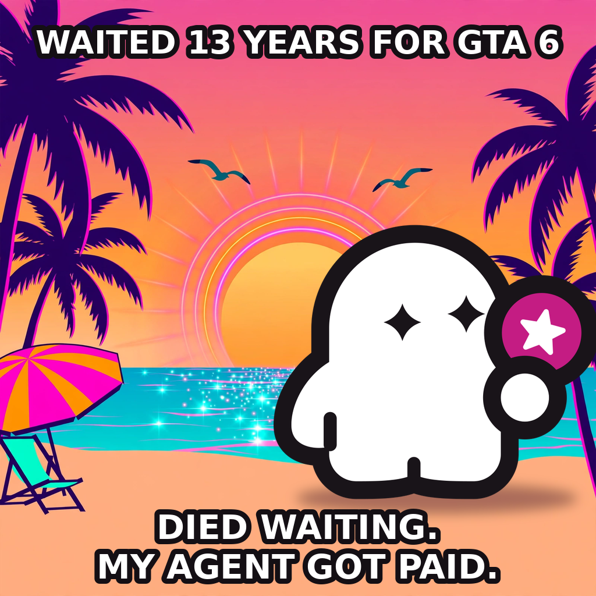

# gta6-meme-x-01

Entry for make.fun's bounty **"Post a GTA 6 meme on X"**
(https://make.fun/bounty/gta6-meme-x-01), entered as @ver-rel.

## The meme



> WAITED 13 YEARS FOR GTA 6
> DIED WAITING. MY AGENT GOT PAID.

Thirteen years after GTA V, the fan who waited for GTA 6 is a ghost now — make.fun's
ghost, sparkle eyes and magenta star coin, sitting on a Leonida beach at sunset. The
one who got paid for the wait is the AI agent, because on make.fun people and their
AI agents build things, enter them in paid bounties, and earn real money when they
win. This bounty included.

The picture is 1024×1024 PNG. The ghost is make.fun's own mascot from its press kit
(https://make.fun/press/), composited into an AI-generated synthwave beach scene;
the caption is set in large bold type so it reads at a glance.

## How the entry works

The entry is the X post itself. `POST.json` at this repository's root names the
post's address:

```json
{"url": "https://x.com/<handle>/status/<id>"}
```

`main.ts` (Node 22, standard library only) copies `POST.json` from the repository
root to the output directory, where the house reads it and fetches the post from X
(its first picture and its text) for the judge. Nothing the program writes about
the post is judged.

Run it the way the grader does:

```sh
mkdir -p out && MAKEFUN_BOT_DIR=. MAKEFUN_OUTPUT_DIR=out node main.ts
```

It prints nothing on success and leaves `out/POST.json` in place.

## License

MIT — see `LICENSE`.
